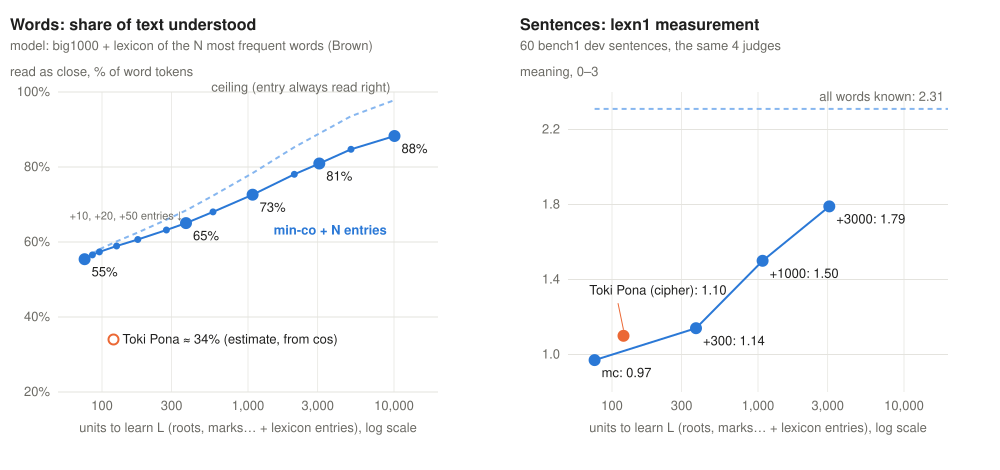

# size0 — lexicon size vs accuracy (from data already collected, no new agents)

Script [analyze.py](analyze.py), results [result.txt](result.txt), curve [curve.json](curve.json), chart [plot.py](plot.py).

## Metric

**U(L), the share of text understood**: the share of content-word tokens (Brown corpus; function words — the FUNC list
from lexn1 — are not counted) that a blind reader reads as *close* (judge: 2 of 0–2), given **L units to learn** (the
retell1 counting rule: roots, parts of speech, roles, marks, particles; min-co v1 = 76, v2b = 82, Toki Pona = 120).
A lexicon of N entries = the N most frequent Brown lemmas: L = 76 + N. A lexicon word is read right with probability
a_lex (1.0 = ceiling; 0.9 = losses on homonyms). Other words are composed from roots, with the accuracy of their frequency
band taken from [big1000](../big1000/README.md) (1000 words, Haiku encoder, Haiku judge).

## Composition by frequency (big1000, close)

| lemma rank | 1–300 | 300–1000 | 1000–3000 | 3000–10 000 | > 10 000 |
|---|---|---|---|---|---|
| model encoder (Haiku) | 62 % | 58 % | 53 % | 43 % | 50 % |
| site math encoder | 27 % | 27 % | 27 % | 20 % | 13 % |

## Curve (a_lex 0.9; ceiling 1.0 in brackets)

| N entries | L | text coverage | U |
|---|---|---|---|
| 0 | 76 | 0 % | 55 % |
| 100 | 176 | 19 % | 61 % (63) |
| 300 | 376 | 34 % | 65 % (68) |
| 1000 | 1076 | 58 % | 73 % (78) |
| 3000 | 3076 | 80 % | 81 % (89) |
| 10 000 | 10 076 | 96 % | 88 % (98) |

Toki Pona (L = 120): no direct measurement with this metric. Estimate from [toki](../toki/README.md) (same 100 words,
cos ≥ 0.5): TP 39 % vs min-co 63 % → about **34 %** at word level. **But at sentence level Toki Pona is ahead** (tpx1:
mc 1.04, tpx 1.54, tp 1.71): single TP words read worse, TP sentences read better.

Check against lexn1 (sentences, same judges): mc 0.97 (L 76) → g300 1.14 → g1000 1.50 → g3000 1.79; tpx 1.10 (L 120).
A linear model 0.97 + 1.34 × coverage predicts 1.29 / 1.57 / 1.80 — it fits for 1000 and 3000, overshoots for 300.

## 1 to 1, 1 to 2, 1 to 3 (what already exists)

| run | 1 word | 2 words | 3 words | note |
|---|---|---|---|---|
| twowords3 (rank, lower is better) | 60 | 52 (exactly 2) | — | n.s. |
| three (hard words, close) | 9 % | 11 % (exactly 2) | 14 % (exactly 3) | W3 − A +4.8 [0 … +9.6] |
| func1 (close) | 36 % (≤ 2, mean 1.05) | — | 44 % (up to 3, mean 1.95) | +7.5 [−4.6 … +20] |
| phrases3 (concepts that are phrases, close) | 35 % | 52 % (one per English word) | — | word by word is better |

Only func1 lets the encoder choose the length ("up to"); the other runs force a fixed number of words. Each extra word adds +2…+8 pp and is never significant, except for concepts that are phrases in English too.

## Caveats

- The curve is a **model**, not a measurement: a_lex is assumed; frequency bands come from one run with a Haiku judge.
- Toki Pona on the word chart is converted from another metric (cos) — order of magnitude only.
- There is no 1/2/3-word or frequency breakdown for Toki Pona at all.
