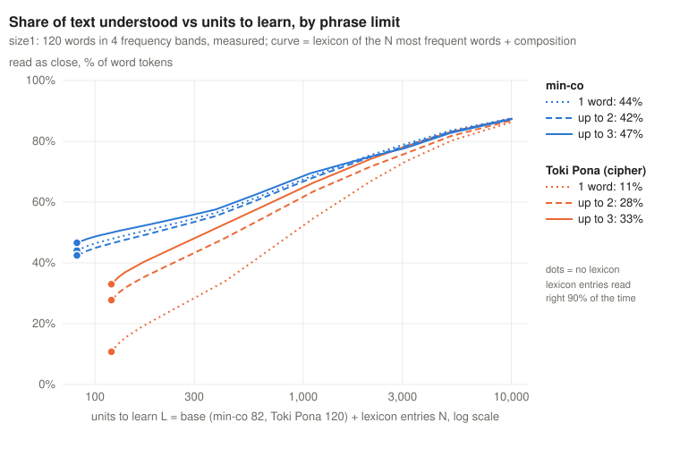
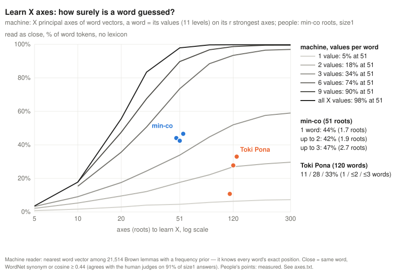

# size1 — phrase limit barely matters for min-co (43 / 41 / 45 %), Toki Pona needs phrases (9 / 27 / 33 %)

Pre-registration: [dec.md](dec.md) (commit `a620173`, before codes). Script [run.py](run.py), results [result.txt](result.txt)
(including every word with its codes), curve [curve.json](curve.json), chart [plot.py](plot.py), codes
[codes.json](codes.json), readings and scores [answers/](answers/).

## Result (120 words, first answer, 2 readers × 2 judges per word and variant; judges agree exactly on 91 %)

| close | 1 word | up to 2 | up to 3 | words per code (k1 / k2 / k3) |
|---|---|---|---|---|
| **min-co** (82 units) | 43 % | 41 % | 45 % | 1.00 / 1.61 / 2.29 |
| **Toki Pona, cipher** (120 units) | 9 % | 27 % | 33 % | 1.00 / 2.00 / 2.98 |

| paired difference, pp [95 %] | min-co | Toki Pona |
|---|---|---|
| up to 2 − 1 word | −1.7 [−7.7 … +4.6] | **+17.9 [+10.8 … +25.2]** |
| up to 3 − 1 word | +2.1 [−6.5 … +10.6] | **+23.8 [+14.6 … +32.7]** |
| up to 3 − up to 2 | +3.8 [−4.6 … +12.1] | +5.8 [−2.3 … +13.8] |
| Toki Pona − min-co | 1 word −33.3; up to 2 −13.8; up to 3 −11.7 (all intervals below 0) | |

**Rule from dec.md: all min-co intervals include 0 → for reading single words the phrase limit does not matter; choose
it by learnability (shorter).** A min-co word already holds up to 3 roots, so a second and third word add little; given
the freedom, the encoder kept one word in 39 % (k2) and 23 % (k3) of codes. Toki Pona words are one root each, so it
needs phrases: going from 1 to 2 words triples its accuracy, the third word adds a little more.

By frequency band (close): min-co k1 53 / 40 / 42 / 35 % from the most to the least frequent band; Toki Pona k3
32 / 32 / 37 / 32 % — flat, because its phrases are equally vague for common and rare words.

## The curve

U(N) — share of Brown content-word tokens read close, with a lexicon of the N most frequent lemmas (entries read right
90 % of the time) and the measured band accuracy for the rest; L = 82 + N (min-co) or 120 + N (Toki Pona).

| N entries | min-co 1 / ≤2 / ≤3 | Toki Pona 1 / ≤2 / ≤3 |
|---|---|---|
| 0 | 44 / 42 / 47 % | 11 / 28 / 33 % |
| 300 | 56 / 55 / 58 % | 34 / 48 / 53 % |
| 1000 | 68 / 68 / 69 % | 55 / 64 / 66 % |
| 3000 | 79 / 78 / 78 % | 73 / 76 / 78 % |

The three min-co lines nearly coincide. Toki Pona starts far lower but the gap closes as the lexicon grows: from about
3000 entries the language under the lexicon hardly matters, because the lexicon covers 80 % of the text.

Claude's forecast (min-co 50 / 56 / 58, Toki Pona 25 / 38 / 43) was wrong for min-co (no gain from phrases) and too high
for Toki Pona.

## Caveats

- **Word level only.** In sentences Toki Pona reads better than min-co ([tpx1](../tpx1/README.md): tpx 1.54 vs mc 1.04):
  context resolves its broad words. This run says nothing about sentences.
- Absolute levels drift between runs (min-co without lexicon: 44 % here, 55 % in [size0](../size0/README.md) with a Haiku
  encoder and judge); compare only within this run.
- The dec.md count was wrong: 1440 readings (720 per language), not 720; each judge got 960 lines, as designed (2/3 each).
- The Toki Pona encoders first counted `pi` as free: 16 phrases over the limit were rewritten by the same encoders before
  any reading.
- One Toki Pona reader (tp2a) deliberately gave different answers to identical phrases; this mostly affects k1, where
  many words share one Toki Pona word.
- The curve is a model: a_lex = 0.9 assumed; ranks above 10 000 use the 3001–10000 band.

## For comparison: a machine code with no human limit ([machine.py](machine.py), [machine.txt](machine.txt); grey lines)

Not a language, a computed reference. 82 units = the 82 best axes of word vectors (PCA of ConceptNet Numberbatch over
21,514 Brown lemmas). A word is written as its continuous values on those axes, keeping the 1, 2 or 3 largest ("sparse")
or all 82 rounded to 11 levels like min-co's −5..+5 ("dense ±5"). Decoding = nearest word vector; close = same word or a
WordNet synonym (stricter than the human judges' "close").

| code | no lexicon | N = 1000 | N = 3000 |
|---|---|---|---|
| 1 number | 1 % | 58 % | 80 % |
| 2 numbers | 7 % | 61 % | 81 % |
| 3 numbers | 19 % | 67 % | 84 % |
| 82 numbers (±5) | 98 % | 99 % | 99 % |
| min-co, up to 3 words (people) | 47 % | ≈ 69 % | ≈ 78 % |

- With 1–3 values per word the machine is **far worse** than min-co without a lexicon (1–19 % vs 42–47 %): best-variance
  axes are not where words sit, while human roots are chosen so that one root + value lands near a word.
- With all 82 values a word is recovered almost always — but that code is 82 numbers per word, and the decoder must know
  the vector of every one of 21,514 words, i.e. it has memorised the whole lexicon. The human limit is exactly what rules
  this out.
- With a large lexicon (N ≥ 2000) the sparse machine lines pass min-co: the lexicon entries count as remembered 100 %
  (people: 90 %).

## Learn X axes: how surely is a word guessed? ([axes.svg](axes.svg), [machine_axes.py](machine_axes.py), [axes.txt](axes.txt))

Machine: X = top principal axes of Numberbatch word vectors; a word = its values (11 levels, like −5..+5) on its r strongest
axes; reader = nearest word vector with a frequency prior. "Close" proxy: same word, WordNet synonym or cosine ≥ 0.44 —
agrees with the human judges on 91 % of the 1440 judged size1 answers. Token-weighted, no lexicon.

At X = 51 (min-co has 51 roots): machine 5 / 18 / 34 % with 1 / 2 / 3 values, 74 % with 6, 90 % with 9; min-co 44 / 42 / 47 %
with 1.7 / 1.9 / 2.7 roots per code (size1 judges; re-judged in roots1 with the other arms: 39 / 42 / 46 %, as on the chart).

- **Per value, min-co beats PCA axes**: 1.7 roots read 44 %, the machine needs ~4 values for that. A root is a meaningful
  centre (GOOD, PLACE) that already lands near words; a PCA axis is a global direction shared by thousands of words.
- **With 6+ values the machine wins by far** — because its reader knows the exact position of all 21,514 words (it has
  memorised the lexicon) and values are exact. A human reader can't; a human encoder can't compute 6 projections.
- More axes beyond ~120 add little: the bottleneck is the number of values per word, not the number of axes.
- **Min-co with fewer roots** ([roots1](../roots1/README.md), blue line; the 10 / 20 / 30 most used roots): ≤ 3 words
  14 / 20 / 34 / 46 % at 10 / 20 / 30 / 51 roots — still above the machine's 3-value line at every X, but steep: no
  plateau by 51. v2c roots (green) 51 % vs v2b 46 % (+8.8 pp, interval touches 0).
